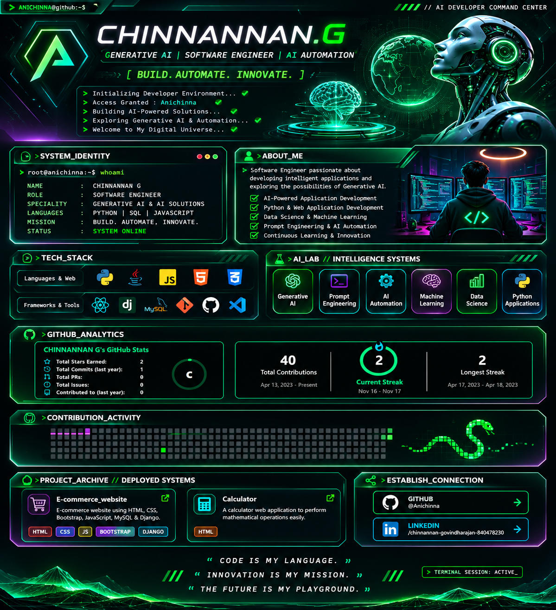

<!--
  NEON AI DEVELOPER COMMAND CENTER
  GitHub Profile README


<div align="center">



</div>
-->


<!-- ===================================================== -->
<!-- CHINNANNAN G - CYBERPUNK AI DEVELOPER COMMAND CENTER -->
<!-- ===================================================== -->

<div align="center">


<br/>


</div>

---

<!-- SYSTEM IDENTITY + ABOUT ME -->

<table width="100%">
<tr>
<td width="48%" valign="top">

<h3>🟢 &gt; SYSTEM_IDENTITY</h3>

```bash
root@anichinna:~$ whoami

NAME        : CHINNANNAN G
ROLE        : SOFTWARE ENGINEER
SPECIALITY  : GENERATIVE AI & AI SOLUTIONS

LANGUAGES   : PYTHON | SQL | JAVASCRIPT

MISSION     : BUILD. AUTOMATE. INNOVATE.

STATUS      : SYSTEM ONLINE
```

</td>
<td width="52%" valign="top">

<h3>🟢 &gt; ABOUT_ME</h3>

```yaml
name: Chinnannan G

role: Software Engineer

passion:
  - Generative AI
  - AI-Powered Applications
  - Python Development
  - Data Science & ML
  - Prompt Engineering
  - AI Automation

mindset: Continuous Learning
mission: Build Intelligent Solutions
```

**Core Objectives**

- ☑ AI-Powered Application Development
- ☑ Python & Web Application Development
- ☑ Data Science & Machine Learning
- ☑ Prompt Engineering & AI Automation
- ☑ Continuous Learning & Innovation

</td>
</tr>
</table>

---

<!-- TECH STACK -->

<h3>⚡ &gt; TECH_STACK</h3>

<table width="100%">
<tr>
<td width="50%" align="center">

**LANGUAGES & WEB**


</td>
<td width="50%" align="center">

**FRAMEWORKS & TOOLS**


</td>
</tr>
<tr>
<td colspan="2" align="center">

**AI / DATA SCIENCE / AUTOMATION**


</td>
</tr>
</table>

---

<!-- AI LAB -->

<h3>🧪 &gt; AI_LAB // INTELLIGENCE_SYSTEMS</h3>

<table width="100%">
<tr>
<td align="center">


</td>
<td align="center">


</td>
<td align="center">


</td>
</tr>
<tr>
<td align="center">


</td>
<td align="center">


</td>
<td align="center">


</td>
</tr>
</table>

---

<!-- GITHUB ANALYTICS -->

<h3>📊 &gt; GITHUB_ANALYTICS</h3>

<div align="center">


<br/><br/>


</div>

---

<!-- CONTRIBUTION ACTIVITY -->

<h3>🟢 &gt; CONTRIBUTION_ACTIVITY</h3>

<div align="center">


</div>

---

<!-- PROJECT ARCHIVE -->

<h3>🚀 &gt; PROJECT_ARCHIVE // DEPLOYED_SYSTEMS</h3>

<table width="100%">
<tr>
<td width="50%" valign="top">

<h3>🛒 E-commerce Website</h3>

An e-commerce web application developed using:

- HTML & CSS
- JavaScript
- Bootstrap
- MySQL
- Django


</td>
<td width="50%" valign="top">

<h3>🧮 Calculator Application</h3>

A calculator web application designed to perform mathematical operations easily.

**Features**

- Arithmetic Operations
- Interactive User Interface
- Responsive Layout
- JavaScript Functionality


</td>
</tr>
</table>

<div align="center">

<a href="https://github.com/Anichinna?tab=repositories">

</a>

</div>

---

<!-- CONNECT -->

<h3>🌐 &gt; ESTABLISH_CONNECTION</h3>

<div align="center">

<a href="https://github.com/Anichinna">

</a>

<a href="https://www.linkedin.com/in/chinnannan-govindharajan-840478230/">

</a>

<br/><br/>


</div>

---

<!-- FOOTER -->

<div align="center">


### `❝ CODE IS MY LANGUAGE. ❞`

### `❝ INNOVATION IS MY MISSION. ❞`

### `❝ THE FUTURE IS MY PLAYGROUND. ❞`


**BUILD. AUTOMATE. INNOVATE.**

</div>

<!-- END OF COMMAND CENTER -->
